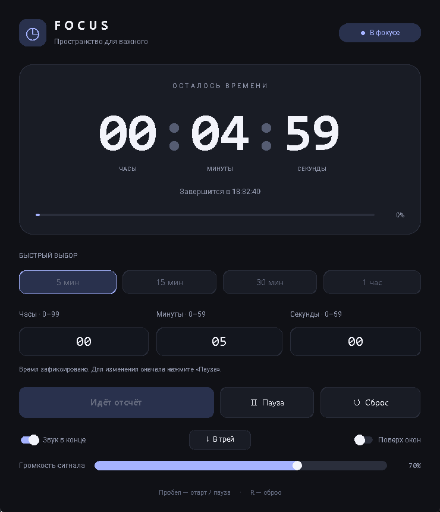

# FOCUS · Таймер для Windows

Минималистичный таймер с тёмным интерфейсом, крупными цифрами, пресетами,
системным треем и настраиваемым звуковым сигналом. Весь код приложения
находится в одном файле `focus_timer.pyw`; сетевые запросы и внешние
аудиофайлы не используются.



## Возможности

- Тёмная тема, скруглённые элементы, индикатор прогресса и живые цифры.
- Часы 0–99, минуты и секунды 0–59; стрелки ↑/↓ меняют выбранное поле.
- Пресеты: 5, 15, 30 минут и 1 час.
- Старт, пауза, продолжение, сброс и повторный запуск.
- Точный отсчёт по монотонным часам: задержка перерисовки не удлиняет таймер.
- В конце: мелодичный сигнал около 7 секунд с плавным затуханием, пульсация
  рамки и постоянный статус завершения.
- Регулировка громкости сигнала (0–100%) прямо в окне; при выключенном звуке
  ползунок блокируется.
- Системный трей: кнопка «В трей», сворачивание крестиком во время активного
  сеанса, цветная иконка со статусом и меню управления.
- Режим «Поверх окон».
- Сохранение настроек: звук, громкость, «Поверх окон» и последняя выбранная
  длительность.
- Горячие клавиши: Пробел / Enter — старт или пауза, R — сброс.

## Требования

- Windows 10 или Windows 11.
- Python 3.10+ — только для запуска из исходников.
- Для готового `FocusTimer.exe` Python не нужен.

## Быстрый старт

### Готовый EXE

1. Скачайте `FocusTimer.exe` из раздела **Releases** на GitHub.
2. Запустите файл двойным щелчком.

EXE не подписан цифровой подписью, поэтому Windows SmartScreen может показать
предупреждение. Это нормально для открытого проекта без платной подписи кода.

### Из исходников

В PowerShell, открытом в папке проекта:

```powershell
py -m venv .venv
.\.venv\Scripts\python.exe -m pip install -r requirements.txt
Start-Process -FilePath ".\.venv\Scripts\pythonw.exe" -ArgumentList "focus_timer.pyw"
```

`pythonw.exe` запускает приложение без консольного окна. Не используйте
`python.exe`, `.bat` или `.cmd` для повседневного запуска: они могут открывать
консоль. Если Windows связывает `.pyw` с `pythonw.exe` и CustomTkinter
установлен в этом же интерпретаторе, файл `focus_timer.pyw` можно открыть
двойным щелчком.

Подробная локальная инструкция находится в `reed.txt`.

## Сборка EXE

```powershell
.\.venv\Scripts\python.exe -m pip install pyinstaller
.\.venv\Scripts\python.exe -m PyInstaller --noconfirm --clean --onefile --noconsole --collect-all customtkinter --collect-all pystray --name FocusTimer focus_timer.pyw
```

Готовый файл появится в `dist\FocusTimer.exe`. Сборку нужно выполнять в Windows.
Флаги `--onefile` и `--noconsole` создают один запускаемый файл без консольного
окна. `--collect-all customtkinter` и `--collect-all pystray` включают темы,
шрифты и backend системного трея.

## Тесты

```powershell
.\.venv\Scripts\python.exe -m unittest discover -s tests -v
.\.venv\Scripts\python.exe -m py_compile focus_timer.pyw
```

Тесты проверяют состояние таймера, интерфейс, настройки и генерацию звукового
сигнала.

## Настройки и данные

- Настройки: `%LOCALAPPDATA%\FocusTimer\settings.json`.
- Лог ошибок: `%LOCALAPPDATA%\FocusTimer\focus_timer.log`.
- Чтобы сбросить настройки, удалите `settings.json`.

Приложение не отправляет данные в сеть и не требует интернет-соединения.

## Структура проекта

```text
focus_timer.pyw            исходный код приложения
tests/test_timer.py        автоматические тесты
FocusTimer.spec            конфигурация PyInstaller
requirements.txt           зависимости Python
docs/screenshot.png        скриншот для README
reed.txt                   локальная инструкция по запуску и публикации
LICENSE                    лицензия MIT
THIRD_PARTY_NOTICES.md     лицензии сторонних библиотек
licenses/                  полные тексты лицензий зависимостей
release/                   готовый EXE для GitHub Releases (не коммитится)
```

## Лицензия

Код проекта распространяется по лицензии **MIT** — см. `LICENSE`.
Сведения о сторонних библиотеках и их лицензиях — в
`THIRD_PARTY_NOTICES.md`.
